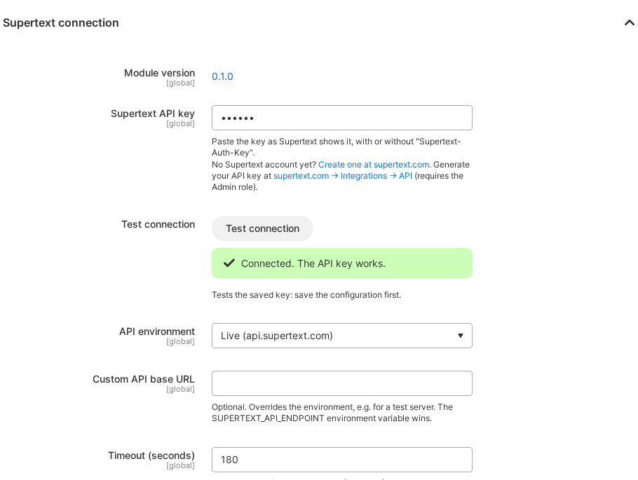
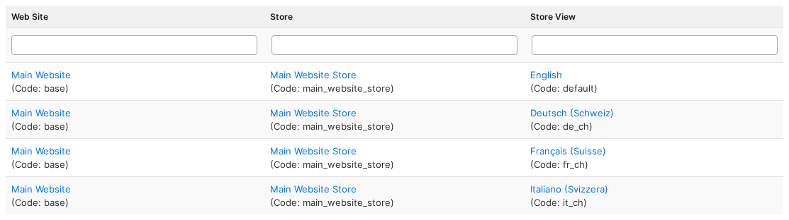
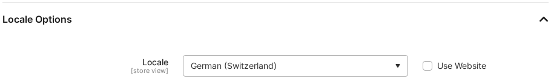
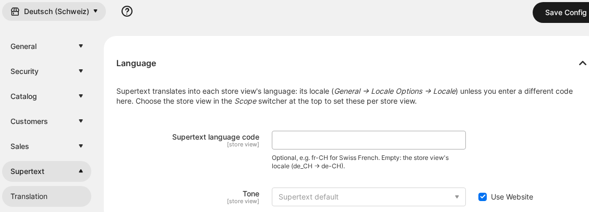

# Installation guide — Supertext Translation for Magento

For administrators setting up the module in a Magento 2 shop (Magento Open Source, Adobe Commerce or Mage-OS).

## Just want to try it?

A ready-to-run container with Mage-OS 3.5 (Magento 2.4.9), English sample products, a category, a CMS page and a block, store views for German (Switzerland), French (Switzerland) and Italian (Switzerland), and this module is in `demo/`. It is also what runs the public Supertext demo. See the *Demo* section of the [developer guide](DEVELOPER.md#demo-railway).

## Requirements

| | |
| --- | --- |
| Magento | Mage-OS 3.5 (Magento 2.4.9) tested; Magento Open Source and Adobe Commerce 2.4.7–2.4.9, Mage-OS 1.x–3.x supported, not yet tested |
| PHP | Whatever your Magento version needs (8.2–8.5), with `ext-curl` (Magento requires it too) |
| Store setup | A store view per language, each with its locale and, where the locale isn't one of Supertext's codes, its Supertext language (step 3) |
| Supertext | An account with an API key, see [Get a Supertext account and API key](#get-a-supertext-account-and-api-key) |
| Network | The web server must reach `https://api.supertext.com` over HTTPS |

## 1. Install the module

The module isn't on the Adobe Commerce Marketplace yet. Install it with Composer, or copy it into `app/code`.

**With Composer** (recommended):

```bash
composer config repositories.supertext vcs https://github.com/Supertext/Magento-Supertext-Translation
composer require supertext/magento-supertext-translation:^0.1
```

**Or by hand:** download `magento-supertext-translation-<version>.zip` from the [Releases page](https://github.com/Supertext/Magento-Supertext-Translation/releases) (or build it with `./build.sh`) and unzip it into `app/code/Supertext/Translation`.

Then, in both cases:

```bash
bin/magento module:enable Supertext_Translation
bin/magento setup:upgrade
bin/magento setup:di:compile                 # production mode only
bin/magento setup:static-content:deploy      # production mode only
bin/magento cache:flush
```

`setup:upgrade` adds one table, `supertext_translation_link`, which records which CMS page or block is the translation of which.

## 2. Set the API key

### Get a Supertext account and API key

1. **Account:** no Supertext account yet? [Log in or create one](https://www.supertext.com/person/en/account/signin) with your email address.
2. **API key:** generate it at [supertext.com → Integrations → API](https://www.supertext.com/en/integrations/api). Only users with the **Admin** role in the Supertext account can do this; otherwise ask your Supertext account admin for a key.

The configuration page links to both, next to the API key field.

### Enter it in Magento

*Stores → Configuration → Supertext → Translation*, group **Supertext connection** (in the *Default Config* scope):

1. Paste your key into **Supertext API key** and click **Save Config**. You can paste it exactly as Supertext shows it, with the leading `Supertext-Auth-Key`, or without it. Magento stores it encrypted.
2. Saving checks the key right away (Supertext's cost-free `features` call; nothing is translated or billed). *API key checked: the connection to Supertext works.* at the top of the page means everything is in place. **Test connection** runs the same check again at any time. The latest result stays visible under **API key check**, with the time it was checked.



On servers you can set the key as the environment variable **`SUPERTEXT_API_KEY`** instead. It takes precedence over the field, keeps the key out of the database, and the configuration page then says that the environment variable is used. A key from the environment is checked the first time a page of the module (configuration, *Translate with Supertext*) or `bin/magento supertext:translate` runs with it.

## 3. Set up the languages

In Magento, a language is a **store view**. The module translates the default values (*All Store Views*) of your products, categories, pages and blocks into the store views, in each store view's language.

1. Add a store view per language: *Stores → All Stores → Create Store View*.

   

2. Set each store view's **locale**: *Stores → Configuration → General → General → Locale Options → Locale*, with the store view chosen in the scope switcher at the top.

   

The default values are taken to be in the default locale (*Default Config* scope; usually the language you write your catalog in). Store views in the same language as the source are not ticked when translating.

### Supertext language and tone

Each store view is translated into a **Supertext language**. Supertext accepts exactly these target codes (from its `features` list, October 2026):

| Language | Supertext codes |
| --- | --- |
| German, English, French, Italian, Portuguese | `de-DE`, `de-CH`, `de-AT`, `en-US`, `en-GB`, `fr-FR`, `fr-CH`, `it-IT`, `it-CH`, `pt-PT`, `pt-BR` |
| Chinese, Serbian | `zh-Hans`, `zh-Hant`, `sr-Latn`, `sr-Cyrl` |
| Swiss German | `gsw-u-sd-chzh` (Zurich), `gsw-u-sd-chbe` (Bern) |
| All others, without region | `bg`, `cs`, `da`, `el`, `es`, `fi`, `hr`, `hu`, `ja`, `ko`, `nb`, `nl`, `pl`, `rm`, `ru`, `sk`, `sl`, `sq`, `sv`, `tr` |

Without a setting, a store view uses:

1. its **locale**, when that already is one of these codes apart from upper/lower case and `_`/`-` (`de_CH` → `de-CH`, `fr_FR` → `fr-FR`, `it_CH` → `it-CH`, `pt_BR` → `pt-BR`);
2. else the **default** of the Supertext SDK, where one is obvious:

| Locale | Default |
| --- | --- |
| a region of a language Supertext offers without region | `es_ES`, `es_MX` → `es`; `nl_NL`, `nl_BE` → `nl`; `sl_SI` → `sl`; `nb_NO` → `nb`; `sv_SE` → `sv`; … |
| Chinese | `zh_Hans_CN` → `zh-Hans`, `zh_Hant_TW`, `zh_Hant_HK` → `zh-Hant` |
| Serbian | `sr_Latn_RS` → `sr-Latn`, `sr_Cyrl_RS` → `sr-Cyrl` |
| a bare language (rare in Magento) | `de` → `de-DE`, `en` → `en-US`, `fr` → `fr-FR`, `it` → `it-IT`, `pt` → `pt-PT`, `zh` → `zh-Hans`, `sr` → `sr-Latn` |

3. else nothing: the store view is **Not mapped** and needs its Supertext language. Regions Supertext doesn't offer are never guessed: `en_IE`, `en_AU`, `de_LI`, `de_LU`, `fr_BE`, `fr_CA`, `it_SM` or `sr_RS` could mean several Supertext languages, so that is your decision.

You can choose another Supertext language for any store view, e.g. `de-CH` for a store view with the locale `de_DE`.

*Stores → Configuration → Supertext → Translation → Language*:

- In the *Default Config* scope, **Store views** lists every store view with its locale and the Supertext language it is translated into: chosen, *(from the locale)*, *(default for the locale)*, or **Not mapped** with a link to set it. It also names the source language.
- With a store view chosen in the scope switcher, **Supertext language** is a Magento select with Supertext's languages as *Name (code)*, the names in your admin interface language (e.g. *German (Switzerland) (de-CH)*), sorted by name. The empty first entry is the default for the store view's locale and names it (*Default: Spanish (es)*); for a locale without a default it reads *– Choose –*. Below the select, the page says what the store view is translated into. Saving accepts only codes from the list. A store view that is not mapped can't be ticked on the *Translate with Supertext* page and nothing is sent for it; translating into it (e.g. with `supertext:translate`) fails with *The language "…" has no Supertext language yet*.
- The same setting counts for the source: the default values are sent in the default locale's language (`en_US` → `en`); if the default store view has the default locale and a Supertext language, its language is used (`de-CH` → `de`).
- **Tone**: *Formal (Sie, vous)*, *Informal (du, tu)* or *Supertext default* (also settable for all store views or per website). Supertext offers no formal/informal choice for English, Swiss German, Romansh, Albanian and Serbian; for those, the module sends the Supertext default, and the *Store views* overview says so.

A code you saved before that isn't in the list (for example one entered in version 0.1) stays selected and is sent as it is until you change it; codes you saved earlier from the list stay as they are. Store views you never set now use their default, so nothing needs migrating.

For automated setups, set the value with Magento's own configuration tools instead of the screen, e.g. `bin/magento config:set --scope=stores --scope-code=es supertext/language/code es` (add `--lock-env` or `--lock-config` to keep it in `app/etc/env.php` or `config.php`); Magento then shows the field as locked for that store view.



## 4. Check it works

Open *Catalog → Products*, select a product and choose **Translate with Supertext** in the **Actions** menu (see the [user guide](USER_GUIDE.md)). Or from the command line:

```bash
bin/magento supertext:translate product <id> [<id>…] [--store=de_ch --store=fr_ch] [--overwrite]
bin/magento supertext:translate category <id>
bin/magento supertext:translate cms_page <id>
bin/magento supertext:translate cms_block <id>
```

Without `--store`, every store view in another language than the default locale is translated.

## Who can translate

Admin users whose role allows **Translate with Supertext** (*System → Permissions → User Roles → Role Resources*) **and** editing the item: *Catalog → Inventory → Products* for products, *Catalog → Inventory → Categories* for categories, *Content → Elements → Pages → Save Page* for pages, *Content → Elements → Blocks* for blocks. The configuration needs *Stores → Settings → Configuration → Supertext Translation*. The *Administrators* role has all of these.

Export for translation and Import translation (on the same page) need the same rights: **Translate with Supertext** and editing the content type; an import reports items of a type the user may not edit and leaves them alone.

## Export for translation and Import translation

Nothing to configure: the *Translate with Supertext* page's **Export for translation** and **Import translation** use the same store views, Supertext languages, rules and rights as translating with Supertext, without calling the Supertext API.

- **Upload size:** at most 10 MB per file. PHP's `upload_max_filesize` and `post_max_size` must allow that (their defaults, 2 MB and 8 MB, are lower: raise them to `10M`/`12M` if editors import large files). The file is read in memory; nothing is stored besides PHP's own temporary upload file.
- A store view that is *Not mapped* doesn't block the export: it is written into the file with its locale (`en_IE` → `en-IE`).

## Interface languages

The module's admin screens (configuration, *Translate with Supertext* page, buttons, mass actions, ACL resources and messages) are available in English, German, French and Italian. They follow each admin user's **Interface Locale**: account menu at the top right → *Account Setting* → *Interface Locale* (or *System → Permissions → All Users*). Magento lists a locale there once its language pack is installed and the admin's static content is deployed for it (`bin/magento setup:static-content:deploy de_CH` in production mode). The module ships `i18n/` files for de_DE, de_AT, de_CH, fr_FR, fr_BE, fr_CA, fr_CH, it_IT and it_CH; other locales show English. Inline translations and language packs that translate the same phrases for `Supertext_Translation` take precedence.

## All settings

| Setting | Scope | Default | Purpose |
| --- | --- | --- | --- |
| Supertext API key | Global | – | Your key, with or without the `Supertext-Auth-Key` prefix; stored encrypted. The `SUPERTEXT_API_KEY` environment variable wins. |
| API environment | Global | Live | `Live` (api.supertext.com), `Staging` or `Testing` Supertext API |
| Custom API base URL | Global | – | Overrides the environment (e.g. a test server). The `SUPERTEXT_API_ENDPOINT` environment variable wins. |
| Timeout (seconds) | Global | 180 | Maximum wait for one translation (30–1800) |
| Send version information to Supertext | Global | Yes | Sends the shop's URL and the versions of this module, Magento and PHP to Supertext when you save these settings and after an update (see [below](#version-information-and-the-api-key-check)). The `SUPERTEXT_VERSION_REPORTS` environment variable wins (`0`, `false`, `off`, `no` or `1`, `true`, `on`, `yes`). |
| Supertext language | Store view | – (the locale, if it is a Supertext code) | The Supertext code the store view is translated into, from Supertext's list (see [Supertext language and tone](#supertext-language-and-tone)). Required where the locale isn't a Supertext code. |
| Tone | Store view | Supertext default | Formal, informal or the Supertext default; only sent where Supertext offers it |
| CMS pages and blocks → Status of new translations | Global | Same as the original | Or *Disabled (review first)*. Only for new copies; translations of products and categories are store-view values and go live at once. |

## Version information and the API key check

**Send version information to Supertext** (group *Supertext connection*) is on by default. The module then tells Supertext which versions you run, so Supertext support can help you faster: when you save the module's configuration, and when an admin page of the module (configuration, *Translate with Supertext*, a translation) or `bin/magento supertext:translate` notices that the module, Magento or PHP was updated or that the result of the API key check changed. A report contains exactly:

- the shop's URL (the secure base URL of the default store view, as Magento knows it),
- the module's name (`Magento-Supertext-Translation`) and version, the Magento edition's name and version, the PHP version and the version of the bundled Supertext SDK,
- whether an API key is set and the result of the latest API key check (status, time, HTTP status, Supertext's error code),
- the address of the ping endpoint below.

**No content, no API key and no personal data are sent.** Reports go from your server, never from the browser; a report takes at most 3 seconds, a failed one is not tried again for an hour, and reporting never slows down or breaks saving or translating (under PHP-FPM it happens after the page has been sent). To turn it off, set the setting to *No* and save, or set the environment variable `SUPERTEXT_VERSION_REPORTS=0` on the server (it wins over the setting, and the configuration page says so). Then nothing is sent at all, and the ping endpoint answers 404.

**The API key check** runs whether or not version information is sent: when you save the configuration, on **Test connection**, when an admin page of the module or the command runs with a key that hasn't been checked yet (e.g. a new `SUPERTEXT_API_KEY`; the module compares a fingerprint of the key, never stores the key itself for this), and when Supertext rejects the key during a translation. It's Supertext's cost-free `features` call. The configuration page shows the latest result under **API key check** with its time:

| Result | Message |
| --- | --- |
| ok | *API key checked: the connection to Supertext works.* |
| invalid | *Supertext rejected the API key. …* (with the links to generate a key and to create an account) |
| missing | *No API key is set yet. …* (with the same links) |
| unreachable | *The API key couldn't be checked because Supertext can't be reached. …* |
| error | *The API key couldn't be checked: Supertext answered with an error (…).* |

**The ping endpoint** `https://<your shop>/supertext/ping?challenge=…` (`/index.php/supertext/ping` without URL rewrites; the configuration shows the exact address under the setting) is public (no login, no form key) and answers only `{"ok":true,"plugin":"Magento-Supertext-Translation","challenge":"…"}`, so Supertext can see that the shop is reachable from the internet. It returns nothing else: no versions, no settings, no data, and it is sent with `Cache-Control: no-store`, so neither Magento's full-page cache nor Varnish keeps it. If a firewall, a CDN or a maintenance page sits in front of the shop, let this URL through uncached.

The module keeps this state (what was reported last, the latest key check, the key's fingerprint) in Magento's `flag` table under the code `supertext_reporter`.

## Updating

With Composer: `composer update supertext/magento-supertext-translation`; by hand: replace `app/code/Supertext/Translation`. Then run `bin/magento setup:upgrade` (and in production mode `setup:di:compile` and `setup:static-content:deploy`) and `cache:flush`. Settings are kept.

## Uninstalling

```bash
bin/magento module:disable Supertext_Translation
bin/magento setup:upgrade
composer remove supertext/magento-supertext-translation    # or delete app/code/Supertext/Translation
```

Translations made so far stay in your shop: store-view values of products and categories, and the page and block copies. The table `supertext_translation_link` and the row `supertext_reporter` in the `flag` table stay too; delete them by hand if you like (`DELETE FROM flag WHERE flag_code = 'supertext_reporter'`).

## Troubleshooting

| Message | Cause / fix |
| --- | --- |
| *Supertext is not set up yet* | No API key: enter it in the configuration (step 2), or set `SUPERTEXT_API_KEY`. |
| *Authentication failed* / *Supertext rejected the API key* | The key is wrong or revoked. Check that you copied the whole key and run **Test connection**. No Supertext account yet? [Create one at supertext.com](https://www.supertext.com/person/en/account/signin). Generate your API key at [supertext.com → Integrations → API](https://www.supertext.com/en/integrations/api) (requires the Admin role). |
| *No API key is set yet* | Enter the key and save (step 2), or set `SUPERTEXT_API_KEY`. |
| *The API key couldn't be checked because Supertext can't be reached* | The server can't reach `api.supertext.com` (firewall, proxy, DNS). Translations need the same connection. |
| *The API key couldn't be checked: Supertext answered with an error (…)* | Usually temporary; run **Test connection** again later. If it stays, contact Supertext with the code shown. |
| *You are not allowed to edit this item* | The user's role lacks the resource for that kind of item (see *Who can translate*). |
| *Your shop has only one store view* | Add a store view per language (step 3). Magento in single-store mode has nothing to translate into. |
| *URL key "…" is already used in this store view* | Another product or category has that URL in the store view. The texts are translated, the URL key is kept; set one by hand. |
| *The original is assigned only to this store view* | The page or block is not in the source language's store views. Assign it to *All Store Views* or the source store views first. |
| *The translation could not be saved: …* | Magento rejected the copy (e.g. a page URL key conflict). The message names the reason. |
| *Too many requests to Supertext* | Supertext's per-second limit was still exceeded after 4 automatic retries. Wait a moment and translate again. |
| *Your Supertext translation limit is exceeded* | Your Supertext plan's volume is used up. |
| *Timed out waiting* | Very long content: raise the *Timeout* (and PHP's `max_execution_time`). |
| *Could not reach Supertext* | The server can't make outbound HTTPS calls; check the firewall or proxy (`HTTPS_PROXY`). The reason follows in brackets. |
| *The language "…" has no Supertext language yet* / *Not mapped* | The store view's locale is neither a Supertext code nor has a default (e.g. `en_IE`, `de_LI`, `fr_BE`). Choose its **Supertext language** in the select in store view scope (see [Supertext language and tone](#supertext-language-and-tone)). |
| *The source language "…" (the default locale) has no Supertext language yet* | The default locale's language isn't one Supertext translates from. Choose the Supertext language of the default store view, or change the default locale. |
| *Supertext does not translate from "…" into "…"* | A saved Supertext language that Supertext doesn't offer, or the same language as the source. Choose another one from the list in store view scope (step 3). |
| *Supertext offers no formal or informal tone for this language* | Supertext refused the tone for a code the module's list doesn't know. Set the store view's tone to *Supertext default*. |
| *The Supertext translation came back incomplete* | Supertext's answer lacked a field; nothing was saved for that item. Translate it again. |
| No **Translate with Supertext** in the Actions menu or on the edit page | Module disabled, missing `setup:upgrade` / `setup:di:compile`, or the user's role lacks *Translate with Supertext*. Flush the cache. |

Failed translations are logged to `var/log/system.log` (lines starting with `Supertext:`).

## Mage-OS's own automatic translation

Mage-OS 3 ships its own AI translation module (*Stores → Configuration → AI Integration*, DeepL or OpenAI), **off** by default. If you switch it on with periodic re-translation, it can overwrite store-view values that Supertext wrote, and the other way round. Use one of them per store view.

## Security notes

- Prefer the `SUPERTEXT_API_KEY` environment variable on servers: the key then never sits in the database or its backups.
- The module only talks to the Supertext API you configured. Documents are deleted from Supertext right after download (and expire after 24 hours anyway).
